<p align="center">
  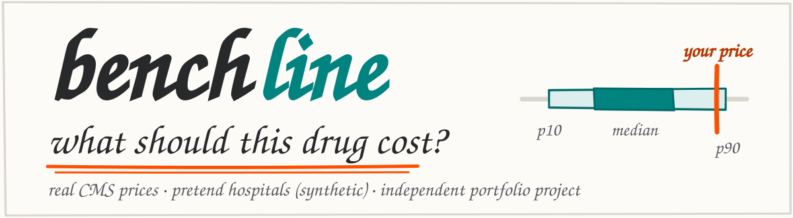
</p>

Benchline benchmarks hospital pharmacy prices. It takes weekly CMS NADAC drug acquisition costs,
groups products that share a description, and keeps a percentile benchmark (p10, p25, p50, p75, p90)
for each group up to date as every price change arrives over Kafka. It flags unusual price moves for
review and shows where a purchase sits against its benchmark.

> Independent portfolio project. Not affiliated with or endorsed by Vizient, Inc.

The headings and explanations below are hand-lettered images, because Markdown cannot change fonts.
Every image has the same text as its alt text, and every command is real text you can copy.

---


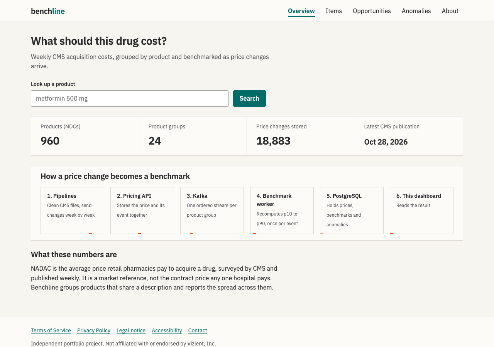

*Overview. Numbers come from the real NADAC data in the demo snapshot.*

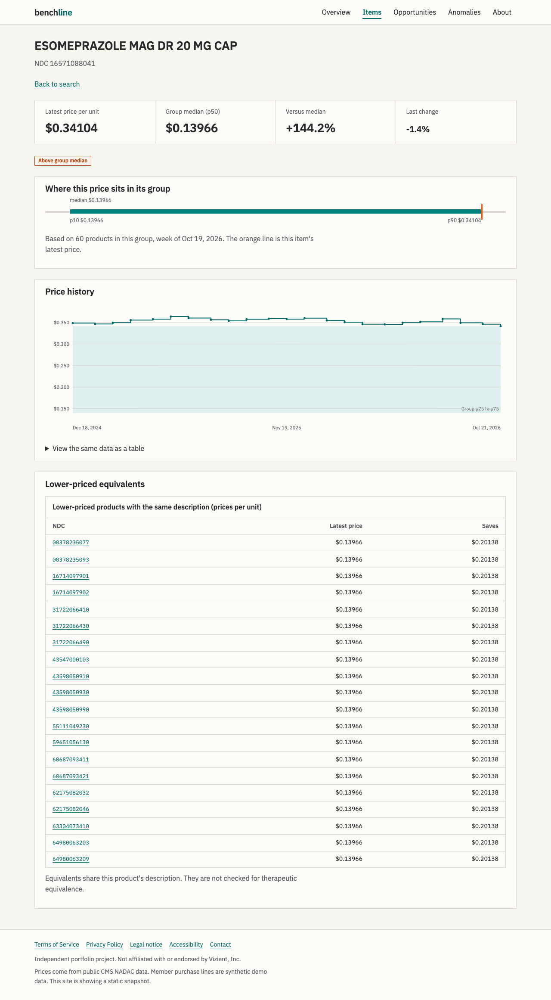

*One product: its price history, where it sits in its group (the orange line), and cheaper products with the same description.*

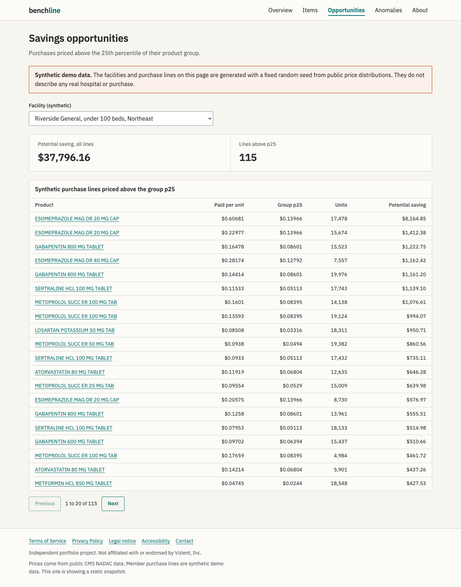

*Savings opportunities. The hospital and its purchases are synthetic and the page says so.*

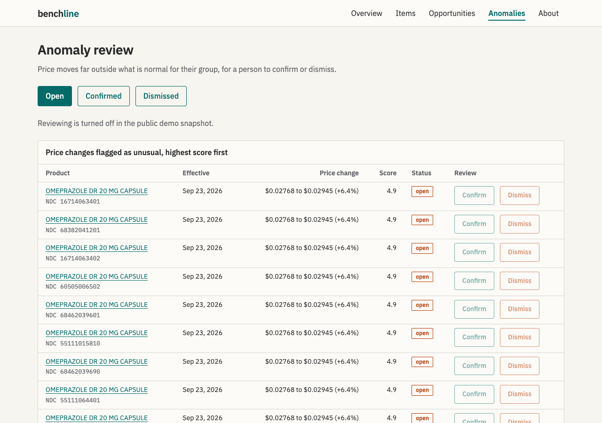

*Odd price moves, for a person to confirm or dismiss. Each row shows its NDC, because CMS often reprices a whole group on one day.*

<p align="center">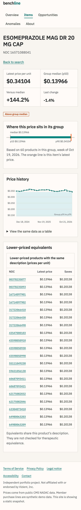</p>

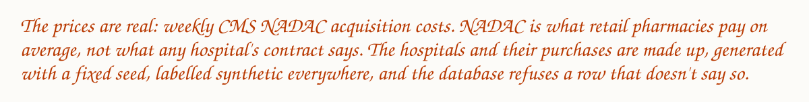

---


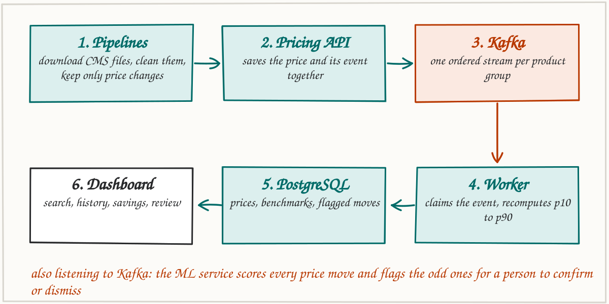

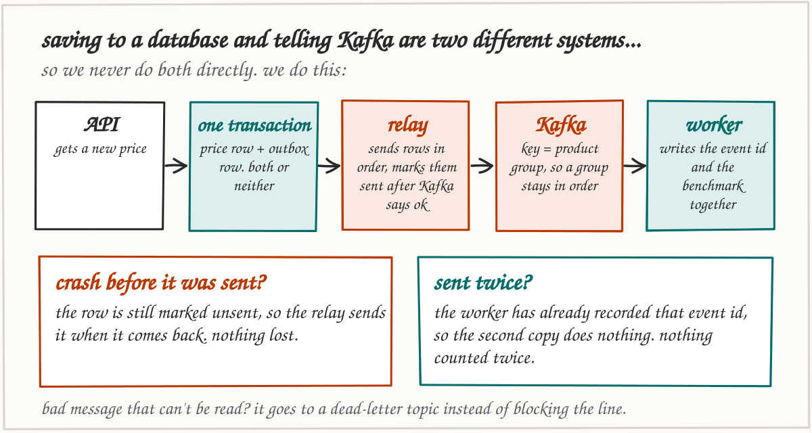

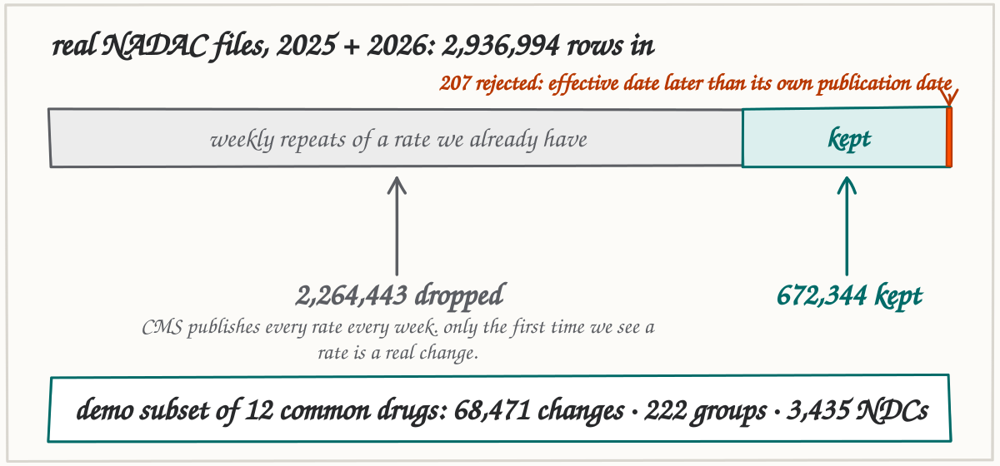

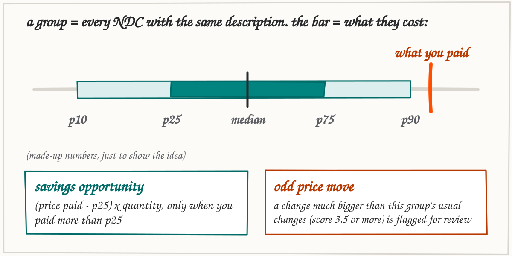

More detail: [architecture](docs/architecture.md), [decision records](docs/adr), [KPI definitions](docs/kpis.md).

---

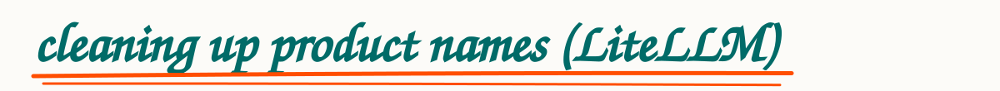

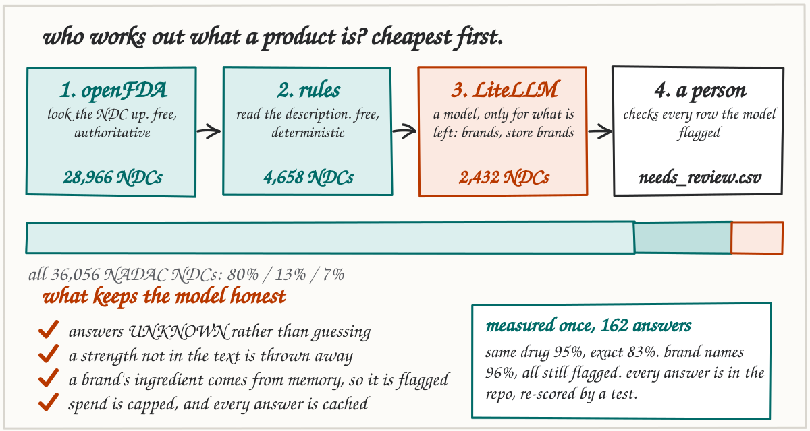

Grouping by raw description text splits one drug across many groups. The item normalizer works out
ingredient, strength and form for every NDC, using the cheapest trustworthy source first, and calls an LLM
through [LiteLLM](https://github.com/BerriAI/litellm) only for the brand and store-brand names nothing else can
read. On the real data, 6,934 groups by raw text become 6,673 groups by product; the free layers are right
99.3% of the time where they claim to know the drug. The model was measured once (Claude Haiku 5.5, 162 answers,
scored against openFDA): the same drug **95.1%** of the time (82.7% exact), and **96.3%** on brand names, every one of
which is still flagged for review. It is one small run; every answer is committed as a fixture and a test reproduces the numbers with no key.
One command repeats it:

```bash
export BENCHLINE_LLM_MODEL=anthropic/claude-haiku-5-5 ANTHROPIC_API_KEY=...
uv run --project pipelines python -m benchline_pipelines normalize-eval --llm --sample 200 --silver data/full/silver/nadac.parquet
```

It runs with no key at all (unresolved items keep their old group and are flagged), directly through the
LiteLLM library with retries and a fallback model, or through a LiteLLM gateway with a budget-capped virtual key.
Details, guardrails and limits: [docs/item-normalization.md](docs/item-normalization.md).

---


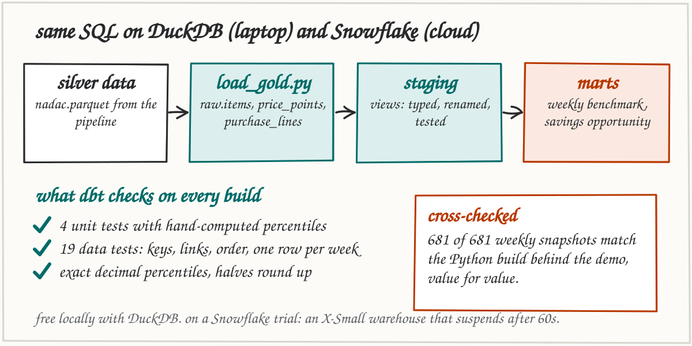

The gold tables also load into a warehouse, where dbt rebuilds two of the service's SQL models: the weekly
p10 to p90 benchmark and the savings opportunity. The same project runs on DuckDB (free, local) and on
Snowflake. Unit tests pin hand-computed percentiles, data tests guard keys and ordering, and on the 12-drug data
all 681 weekly snapshots match the Python build value for value.

```bash
cd warehouse
uv sync
uv run python load_gold.py                                   # add --target snowflake for Snowflake
uv run dbt build --project-dir dbt --profiles-dir dbt        # DBT_TARGET=snowflake for Snowflake
```

Snowflake setup and connection: [docs/warehouse.md](docs/warehouse.md).

---


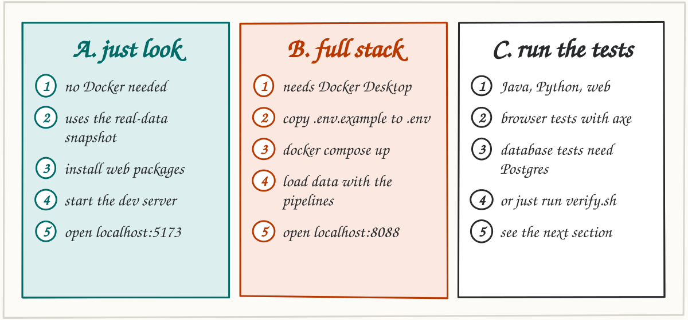

### Install the tools once

| Tool | Needed for | Check |
|---|---|---|
| Node 22 or newer, with pnpm (`corepack enable`) | the web app | `node -v` |
| Python 3.12 and [uv](https://docs.astral.sh/uv/) | pipelines, ML service, scripts | `uv --version` |
| JDK 17 or newer (Gradle downloads JDK 21 itself) | the Java services | `java -version` |
| Docker Desktop | the full stack (path B) and the Docker-based tests | `docker --version` |

### A. Just look (no Docker)

This serves the real-data snapshot in `web/public/demo`. Nothing else has to be running.

```bash
cd web
pnpm install
VITE_DEMO_MODE=true pnpm dev
# open http://localhost:5173
```

### B. The full stack (Docker)

```bash
cp .env.example .env
# edit .env: set POSTGRES_PASSWORD and DEV_JWT_SECRET (32+ characters)

docker compose up -d --build        # Postgres, Kafka, migrations, both Java services, ML service, web
```

Load real data (about 250 MB download), then replay it through the whole pipeline:

```bash
uv run --project pipelines python -m benchline_pipelines fetch --years 2025 2026
uv run --project pipelines python -m benchline_pipelines silver --contains ATORVASTATIN METFORMIN LISINOPRIL

export DEV_JWT_SECRET=<same value as in .env>
uv run --project pipelines python -m benchline_pipelines replay --weeks 12

DATABASE_URL=postgresql://benchline:<POSTGRES_PASSWORD>@localhost:5432/benchline \
  uv run scripts/seed_synthetic.py --facilities 6 --seed 42
```

Open the app against the live API. The token lets the dev server read the protected pages:

```bash
cd web
VITE_API_BASE_URL=http://localhost:8080 \
VITE_DEV_TOKEN=$(uv run ../scripts/dev_token.py) \
pnpm dev
# open http://localhost:5173
```

The container on http://localhost:8088 shows the public pages. Its Opportunities and Anomalies pages
need a real sign-in provider, which is not set up locally.

Stop everything with `docker compose down` (add `-v` to delete the data).

To rebuild the static demo from the data you just downloaded, with no Docker at all:

```bash
uv run scripts/build_demo_snapshot.py     # writes web/public/demo from data/silver
```

---


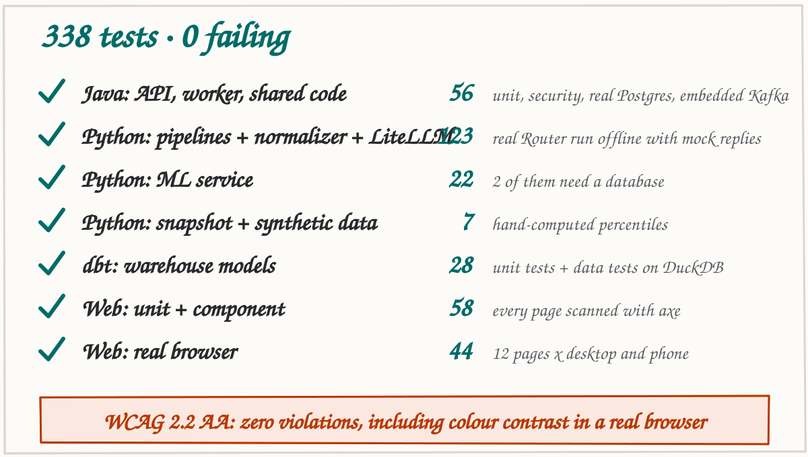

Everything at once (this is also what CI runs):

```bash
./scripts/verify.sh
```

Or one part at a time:

```bash
# web: types, lint, unit tests, "no secrets in the bundle" check
cd web && pnpm install && pnpm typecheck && pnpm lint && pnpm test && pnpm check:bundle

# web: real browser tests with accessibility scans (desktop and phone)
cd web && pnpm exec playwright install chromium && pnpm e2e

# Python
cd pipelines  && uv run ruff check . && uv run mypy benchline_pipelines tests && uv run pytest
cd ml-service && uv run ruff check . && uv run mypy app tests && uv run pytest
uv run --with pytest --with pandas --with pyarrow --with numpy pytest scripts/tests -q

# Warehouse: dbt models, data tests and unit tests on DuckDB
cd warehouse && uv run python load_gold.py && uv run dbt build --project-dir dbt --profiles-dir dbt

# Java
./gradlew test                # fast: unit and web-layer security tests
./gradlew integrationTest     # needs Docker (Testcontainers starts PostgreSQL)
```

No Docker? Point the database tests at any throwaway PostgreSQL 16 instead. The tests create the
schema and empty the tables between tests, so never use a database you care about.

```bash
export TEST_DATABASE_URL=jdbc:postgresql://127.0.0.1:5432/benchline_test
export TEST_DATABASE_USER=postgres TEST_DATABASE_PASSWORD=<password>
./gradlew integrationTest
```

Kafka is embedded in the test JVM, so no broker is needed for tests.

### If a test command fails

| You see | Cause | Fix |
|---|---|---|
| `Executable doesn't exist ... chromium_headless_shell` | Playwright has not downloaded its browser, or a newer one is needed after an update | `cd web && pnpm exec playwright install chromium` |
| Java `integrationTest` shows tests as skipped | No Docker and no `TEST_DATABASE_URL` | Start Docker Desktop, or set `TEST_DATABASE_URL` as above |
| `Connection refused` from the ML service database tests | `TEST_DATABASE_DSN` points at a database that is not running | Start it, or leave the variable unset so those 2 tests skip |
| `Port 4173 is already in use` | An old preview server is still running | `pkill -f "vite preview"` and run again |

---


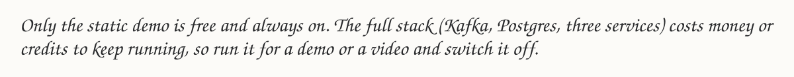

The static demo goes on Cloudflare (free, no request limits for static files). Steps, costs and the
other options are in [docs/deployment.md](docs/deployment.md).

---


The committed demo snapshot was built from the real NADAC files with the same grouping rules and the same
scoring code the services use, so the free site needs no backend. Its `manifest.json` records how it was made.

Not built yet: VA Federal Supply Schedule prices, openFDA shortages and Orange Book equivalence,
forecasting, device classification, live updates. See [docs/data-sources.md](docs/data-sources.md).

---


```
apps/            pricing-api, benchmark-worker (Spring Boot)
libs/            java-common, test-support
ml-service/      FastAPI anomaly service
pipelines/       bronze, silver and gold data jobs
warehouse/       loader and dbt project (DuckDB locally, Snowflake)
web/             React + TypeScript (public/demo holds the snapshot)
contracts/       OpenAPI and event JSON schemas
db/migrations/   Flyway SQL
deploy/          Dockerfiles, Helm chart, Terraform, flagd, OTel collector
docs/            architecture, ADRs, security, deployment, data sources, KPIs, README art
scripts/         verify, file-length check, snapshot builders, synthetic data, dev token
```

Security notes are in [docs/security.md](docs/security.md) and [SECURITY.md](SECURITY.md).
Contributing rules are in [CONTRIBUTING.md](CONTRIBUTING.md).

---


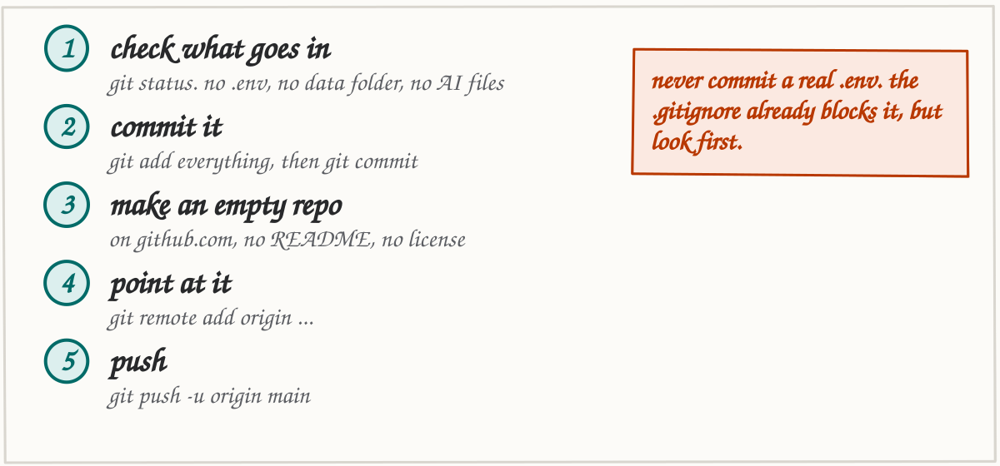

```bash
cd ~/Projects/Benchline

# 1. who you are (only needed once on this machine)
git config user.name  "Your Name"
git config user.email "you@example.com"     # or your GitHub no-reply address, see below

# 2. look before you commit: no .env, no data/, no node_modules
git add -A
git status --short | head -40
git status --short | grep -E '(^|/)\.env$|^.. data/|node_modules' || echo "nothing sensitive is staged"

# 3. commit
git commit -m "feat: initial Benchline implementation"

# 4. create the GitHub repository and push, in one step (needs the GitHub CLI, already signed in)
gh repo create benchline --public --source=. --remote=origin --push
```

Without the GitHub CLI: create an **empty** repository on github.com (no README, no license), then:

```bash
git remote add origin https://github.com/<your-username>/benchline.git
git branch -M main
git push -u origin main
```

Commits on a public repository show the email you committed with. To keep your address private, use
the no-reply address from https://github.com/settings/emails (it looks like
`12345+your-username@users.noreply.github.com`).

After the first push, add the repository secrets and variables listed in
[docs/deployment.md](docs/deployment.md) before enabling the deploy workflows.

## License

MIT. Public data keeps its publisher's terms, listed in [docs/data-sources.md](docs/data-sources.md).
The hand lettering uses the Caveat font under the SIL Open Font License (`docs/art/fonts/OFL.txt`).
