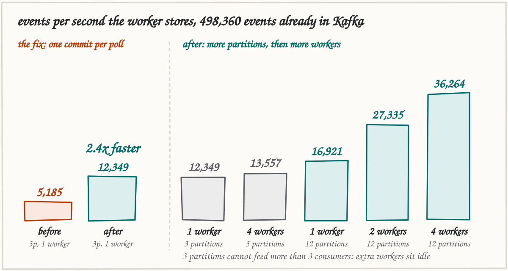
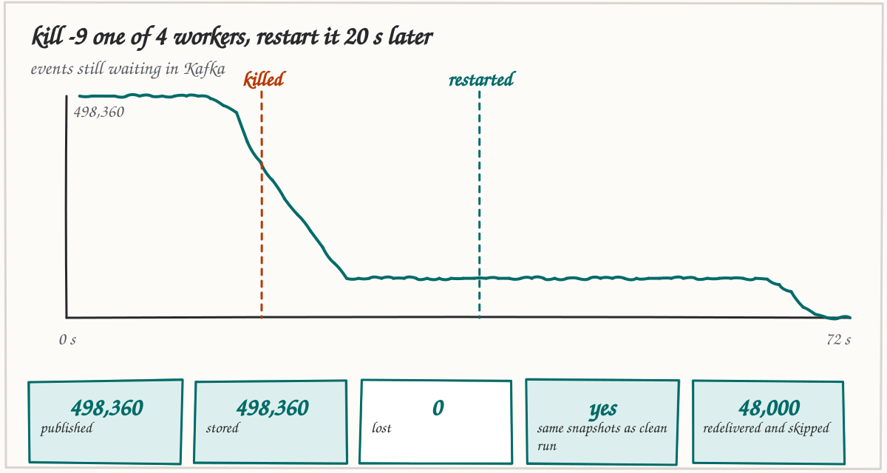

# Performance: load test and failure test

Every number here comes from a recorded run in [docs/perf](perf), produced by the scripts in
[scripts/loadtest](../scripts/loadtest). Everything ran on one laptop (10 CPUs and 8 GB given to Docker): one
PostgreSQL 16, one Kafka 3.9 broker, all services in containers. Read the numbers as relative (before and
after, 3 versus 12 partitions), not as capacity for a real deployment.

## The data

All 14 years of CMS NADAC files, 2013 to 2026, fetched with the pipeline:

| | Rows |
|---|---|
| Rows read | 17,468,000 |
| Rejected by the checks | 5,720 |
| Weekly repeats of a rate already known | 13,856,568 |
| **Price changes (events)** | **3,605,712** |

The scaling and failure tests use a fixed slice: 498,360 events, from September 2025 on plus each product's
rate at the start of the window.

## What the load found

| Problem | How it showed | Fix |
|---|---|---|
| Two batches posted at once deadlocked | HTTP 500 from `price-points:batch` when both created the same new groups in different orders | Rows are stored in one fixed order: group, NDC, date. Regression test in `PriceIngestIT` (fails without the fix) |
| The worker committed once per event | Most database sessions waiting on `COMMIT` (WAL write and sync); four workers burned about 140% CPU each and were no faster than one | One transaction and one commit per Kafka poll; each (group, week) benchmark computed once per poll |
| Partitions and replicas were fixed | Topic hard-coded to 3 partitions, consumer threads to 3 | `KAFKA_PARTITIONS` and `WORKER_CONCURRENCY` |

The worker change is safe because a snapshot is computed as of the end of its week from the stored prices, so
it does not depend on event order or on how many events point at it. Three integration tests pin that a batch
gives the same snapshots as handling the events one by one, that a repeated event id inside a poll is counted
once, and that a redelivered batch changes nothing. The unreadable-message path still sends only the bad record
to the dead-letter topic.

The outbox relay now puts a whole batch in flight and marks it published with one statement, after the broker
has acknowledged every record. It keeps up with ingest in every run (it finishes within a second or two of the
last insert); it was not measured on its own.

### Before and after

498,360 events already in Kafka, 3 partitions, 1 worker, rate measured from the first event stored:

| | Events per second |
|---|---|
| One commit per event | 5,185 |
| One commit per poll | **12,349** (2.4 times) |

## Scaling with partitions and workers

The same backlog drained again for each setup, 3 consumer threads per worker. The snapshot digest was identical
in all five runs, so the partition and replica counts do not change the result.

| Partitions | Workers | Consumer threads | Events per second |
|---|---|---|---|
| 3 | 1 | 3 | 12,349 |
| 3 | 4 | 12 (3 busy) | 13,557 |
| 12 | 1 | 3 | 16,921 |
| 12 | 2 | 6 | 27,335 |
| 12 | 4 | 12 | **36,264** |



Three partitions cannot feed more than three consumers, so extra workers sit idle; twelve partitions let four
workers use twelve threads. The scaling is not linear (2.1 times for four workers over one) because all of them
write to the same PostgreSQL.

## Killing a worker

One of four workers is killed with `kill -9` partway through. A killed process cannot commit offsets or finish a
transaction, which is what a crashed pod does. It is restarted 20 seconds later.

**Backlog mode:** 498,360 events are loaded first, then drained.

| | |
|---|---|
| Worker killed after | 161,150 events stored |
| Events published, stored, lost | 498,360, 498,360, 0 |
| Longest stretch with no worker storing anything | 36 s (the dead worker's partitions were the only ones left) |
| Back to zero lag after the restart | 32 s |
| Final snapshots against an undisturbed run | identical (same digest) |

The transaction a killed worker had open rolls back, so Kafka redelivers those events and they are stored fresh:
this run skipped no duplicates. To show duplicate handling directly, every partition was then rewound by 4,000
events and the workers restarted: **48,000 redelivered events, all skipped, stored count and snapshots
unchanged.**



**Live mode:** the same kill while events are still being ingested also lost nothing. Its final snapshots differ
from a clean run, and the difference is timing, not loss. A week's snapshot is computed when its last event
arrives; a row published in a later week but dated inside that week changes the week's value only if it was
already stored by then, and the snapshot is not recomputed when such a row arrives afterwards. Draining the same
data again gave the clean digest. See [the design note](#a-design-note-late-rows) below.

## A design note: late rows

A snapshot belongs to the week of an event's `as_of_date` and uses every stored price dated up to that week's end.
CMS sometimes publishes a rate in a later week with an effective date inside an earlier one. That row creates an
event for the later week only, so the earlier week's snapshot is not refreshed. The stored value depends on
whether the row had arrived when the week's last event was processed. Recomputing from scratch gives the complete
value. Fixing it means also re-queuing the week that contains the row's effective date.

## Reproduce

```bash
# data: every year, then silver
uv run --project pipelines python -m benchline_pipelines --data-dir data/loadtest fetch --years 2013 2014 2015 2016 2017 2018 2019 2020 2021 2022 2023 2024 2025 2026
uv run --project pipelines python -m benchline_pipelines --data-dir data/loadtest silver

# scaling: partitions:replicas lists, one backlog per partition count
scripts/loadtest/scaling.sh 3:1,4 12:1,2,4

# kill test with an exact digest check and 48,000 forced redeliveries
scripts/loadtest/stack.sh up 12
uv run --project pipelines --with "psycopg[binary]" python scripts/loadtest/kill_test.py \
  --mode backlog --silver data/loadtest/silver/nadac.parquet --since 2025-09-01 \
  --expect-digest <digest from a scaling run> --redeliver 4000

# every run's rate from its recorded timeline
python3 scripts/loadtest/summarize.py
```

`POSTGRES_PASSWORD` and `DEV_JWT_SECRET` must be in the environment. The tests use their own Compose project
(`benchline-load`), so a normal `docker compose up` and its volumes are untouched.

## Full history, end to end

All 3,605,712 events, 2013 to 2026, through ingest, outbox, Kafka (12 partitions) and 4 workers with 3 threads
each, with the workers consuming while events were still being loaded.

| | Events | Time | Events per second |
|---|---|---|---|
| First run, 2013 to October 2022 | 2,264,254 | about 1 hour | not a clean rate (see below) |
| Resumed run, October 2022 to 2026 | 1,341,458 | 420 s | **3,193** end to end (ingest 3,227) |

In the resumed run the workers kept pace with the loader: the most events waiting at any moment was 975.

Final state, counted exactly:

| | |
|---|---|
| Price points stored | 3,605,712 |
| Events in the outbox, all published | 3,605,712 |
| Events stored by the workers | 3,605,712 |
| Published but not stored | 0 |
| Dead-letter topic | empty |
| Benchmark snapshots | 613,009 (11,145 groups, 63,079 NDCs) |
| PostgreSQL size | 4.5 GB |

The first run stopped with HTTP 401 after about an hour: the development token the loader minted at the start
expires after 3600 s. The loader now mints a token per request. Re-posting is safe because a row already stored
is rejected as a duplicate, so the second run resumed from where the first stopped. Other work was running on the
laptop during the first run (diagnostics and builds), so its average is not a measurement of the system.

Two spot readings from that run show how the stages share one database: ingest ran at 4,930 events per second
with the workers running and 7,895 with them paused. The worker's recompute is the largest CPU consumer, and
older years cost more per event than recent ones because each item has more price changes inside the 52-week
window.


## Scope

- The ML anomaly service was not running in any of these tests, so its consumer group shows every event as
  unread. Only the benchmark worker's lag is meaningful here.
- The kill is a `SIGKILL` of a Compose container. On Kubernetes a deleted pod receives the same signal with no
  grace period, and the Deployment replaces it.
- A single laptop shares CPU between PostgreSQL, Kafka and every JVM, so a result moves with whatever else
  runs. An earlier set of runs was discarded because a forgotten local cluster was using four CPUs.
